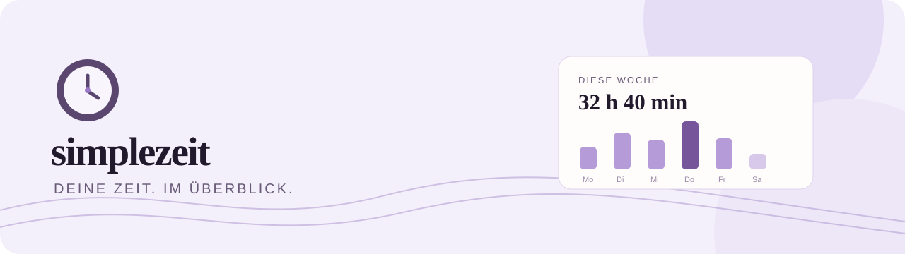
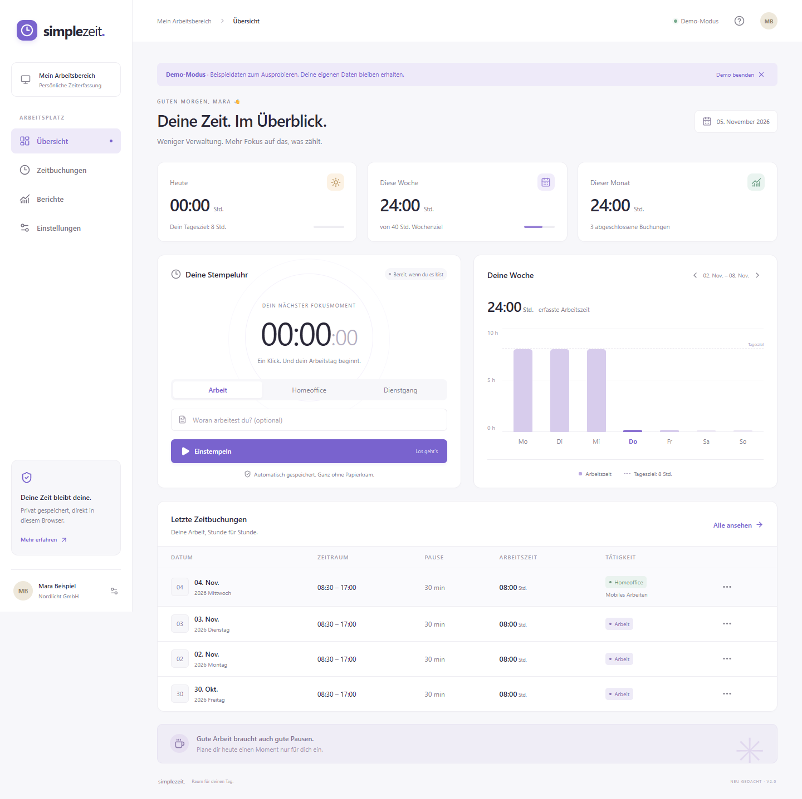

# simplezeit

<div align="center"><p><strong>Lokale Zeiterfassung, die ruhig bleibt.</strong><br>Arbeitstage, Pausen und Berichte – direkt im Browser.</p><p><strong><a href="https://domescobar.github.io/timeattendance/">↗ Live-App öffnen</a></strong></p></div>

## Was simplezeit kann

| Im Alltag                                       | Im Überblick                                   |
| ----------------------------------------------- | ---------------------------------------------- |
| Einstempeln, pausieren, fortsetzen, ausstempeln | Tag, Woche und Monat mit Summen und Wochenziel |
| Buchungen nachtragen, bearbeiten und löschen    | Filter nach Zeitraum, Tätigkeit und Text       |
| Nachtschichten und Zeiten über 24 Stunden       | CSV-Export und Drucken / als PDF speichern     |
| Profil, eigene Felder und helles/dunkles Design | JSON-Sicherung und validierter Import          |

<p align="center"></p>

Die Demo ist isoliert: Beispieldaten verändern keine eigenen Buchungen. Laufende Zeiten bleiben nach dem Neuladen erhalten; mehrere Tabs schützen vor veralteten Schreibständen.

## In drei Schritten

1. **Starten:** Node.js 24 empfohlen; unterstützt werden 22.12+, 24 und 26+ (Node 25 wird von der Testbibliothek nicht unterstützt).
2. **Installieren und öffnen:** `npm ci` und `npm run dev`, dann `http://127.0.0.1:5173` öffnen.
3. **Loslegen:** Einstempeln oder Buchung nachtragen; regelmäßig **JSON-Sicherung** exportieren.

## Daten, Grenzen und Übertragung

simplezeit speichert ausschließlich im `localStorage` des jeweiligen Browsers unter `timeattendance-modern-v1`. Keine Registrierung, kein API-Schlüssel, keine Cloud-Synchronisierung und keine serverseitige Datenbank. Browser, Profil und Webadresse bestimmen den Speicher; `localhost`, `127.0.0.1` und die Live-Adresse haben getrennte Daten. Beim Löschen der Browserdaten gehen lokale Einträge verloren.

Für den Wechsel zwischen Entwicklungsserver und Live-App JSON exportieren und auf der Zieladresse importieren. Der Import wird geprüft und erst nach Bestätigung übernommen. Abgeschlossene Schichten werden ihrem Startdatum zugeordnet; ein Tagesziel entspricht Wochenziel geteilt durch fünf. CSV ersetzt den früheren XLS-Export. PDF entsteht über den Druckdialog mit **„Als PDF speichern“**.

Alte lokale Schlüssel (`zt-bt`, `zt-u`, `zt-ud`, `zt-iw`) werden nur auf derselben Webadresse beim ersten Start übernommen; Originalschlüssel bleiben unverändert. Alte PHP-API, Online-Konten, NFC, GPS und Cordova-Gerätefunktionen gehören nicht zur lokalen Version. Direktes Öffnen von `dist/index.html` als Datei wird nicht unterstützt.

## Entwicklung und Veröffentlichung

```sh
npm run build          # TypeScript-Prüfung und Produktionsbuild
npm run preview        # Produktionsbuild lokal ansehen
npm test               # Zeitlogik und Speicherung prüfen
npm run test:e2e       # Desktop und Mobil testen (Chrome erforderlich)
npm run format         # Quellcode formatieren
npm run publish:pages  # Pages-Deployment per CI auslösen
```

Das ursprüngliche Repository `DomEscobar/timeattendance` ist die öffentliche Quelle. Die Live-App ist unter [domescobar.github.io/timeattendance](https://domescobar.github.io/timeattendance/) erreichbar und verwendet den Unterpfad `/timeattendance/`.

Die CI prüft Pushes und Pull Requests mit Build und Fachtests. Auf `master` deployt derselbe Workflow automatisch zu GitHub Pages; Browser-Szenarien wurden separat lokal verifiziert. Es gibt kein zusätzliches Deployment-Repository. `npm run publish:pages` stößt den konfigurierten Workflow bei Bedarf manuell an.

Historische Angular-/Cordova-Quellen bleiben als Referenz erhalten; die neue Anwendung liegt in `modern/`. [Umfang und Prüfnachweise](docs/REBUILD.md) dokumentieren auch die Migrationsgrenzen. Der Nachweis vom 05.11.2026 umfasst **17 Fachtests und 18 Browser-Szenarien**.

| Verzeichnis                           | Inhalt                                              |
| ------------------------------------- | --------------------------------------------------- |
| `modern/src/`                         | Neue App, Zeitlogik, lokaler Speicher und Tests     |
| `modern/e2e/`                         | Reproduzierbare Browser-Szenarien                   |
| `docs/evidence/`                      | Desktop-/Mobilansichten und getesteter Druckbericht |
| `src/`, `Cordova/`, `e2e/`, `legacy/` | Historische Referenz und Migrationsgrenzen          |

<div align="center"><sub>simplezeit · lokal im Browser · gebaut von DomEscobar</sub></div>
